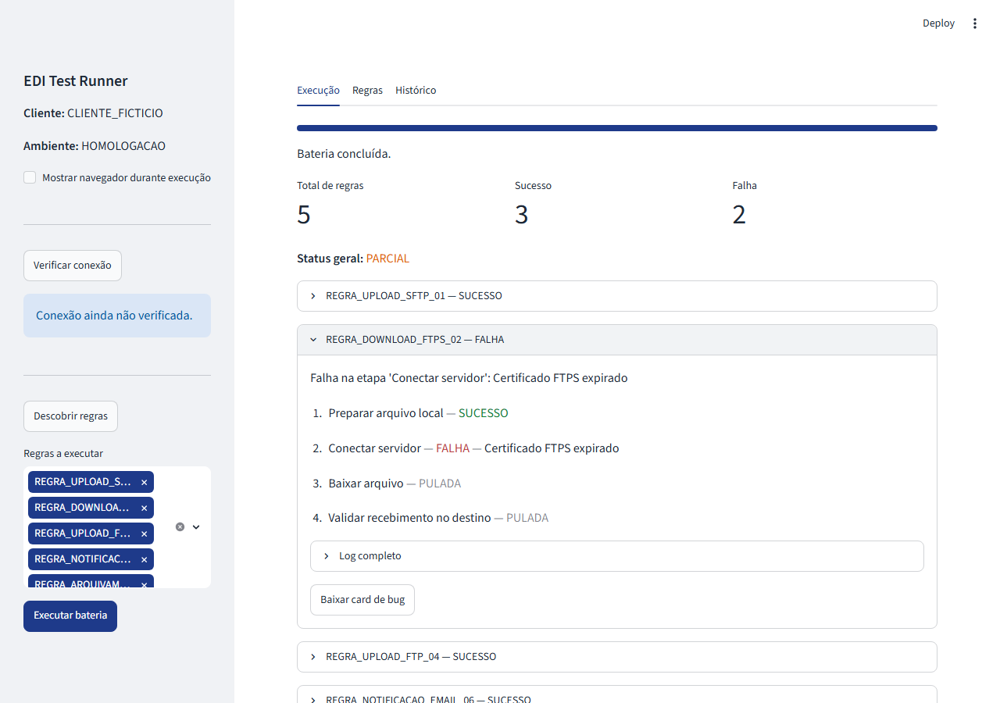

# EDI Test Runner

Automação de testes para plataformas EDI (transferência de arquivos) — Python + Playwright + Streamlit.


> Badges estáticos, atualizados manualmente — o projeto ainda não tem CI/CD (fora de escopo da Fase 1, ver [Roadmap](#roadmap--fases-futuras)).

## Sobre o projeto

Reescrita moderna de uma ferramenta de automação de testes que eu mantinha em PowerShell + WPF + Selenium para validar regras de um sistema EDI corporativo — a plataforma que recebe, valida e transfere arquivos entre uma empresa e seus parceiros (upload/download via SFTP/FTP/FTPS, validação de layout e assinatura, notificação, arquivamento).

A ferramenta anterior funcionava, mas não produzia dados estruturados, não tinha checagem de infraestrutura antes de rodar, e não isolava o estado entre uma regra e outra. Este projeto reconstrói o mesmo propósito — login automatizado, descoberta de regras sem hardcode, execução visual — em cima de uma stack Python moderna, e acrescenta o que faltava: eventos estruturados em JSON, health check pré-voo, reset entre execuções e geração de card de bug pronto para abertura de chamado.

**Por que existe:** portfólio (demonstra a stack que uma vaga de Automation Test Developer para plataformas EDI/file transfer pede diretamente), utilidade real (substituir a ferramenta anterior quando estiver madura) e aprendizado (consolidação de Python moderno além do básico).

## Funcionalidades

- **Login automatizado** no sistema EDI corporativo via Playwright
- **Descoberta automática de regras** cadastradas — sem configurar regra por regra
- **Health check pré-voo**, distinguindo falha de infraestrutura de falha de regra
- **Execução de regra completa**: gera arquivo, aplica, valida no destino, consulta log
- **Reset entre execuções** e **bateria completa** com continue-on-failure
- **Interface web (Streamlit)**: descoberta, seleção, progresso em tempo real, histórico
- **Geração de card de bug** semi-preenchido a partir do resultado de uma falha, pronto para abrir chamado

## O que este projeto NÃO faz

- Não conecta em ambientes de produção
- Não substitui um sistema EDI corporativo
- Não gera testes automaticamente por IA (camada futura, condicional a autorização institucional)
- Não é uma solução multi-tenant

## Stack técnica

- **Python 3.12+**, tipagem completa (sem `Any` sem justificativa)
- **Playwright** (síncrono) para automação web
- **Pydantic v2** para validação de dados e serialização JSON
- **Streamlit** para a interface web
- **uv** como gerenciador de dependências
- **ruff** (lint + format), **mypy** (strict), **pytest** + **pytest-cov**

## Screenshot



*Dados 100% sintéticos — nomes de regra e cliente fictícios, gerados contra um ambiente de teste mockado (ver [Ambiente de teste](#ambiente-de-teste-fase-1)).*

## Como rodar localmente

```bash
# Instalar dependências (uv gerencia o Python 3.12 também, se necessário)
uv sync
uv run playwright install chromium

# Configurar variáveis de ambiente
cp .env.example .env
# edite .env com a URL do ambiente EDI e credenciais

# Rodar a interface web
uv run streamlit run src/edi_test_runner/ui/streamlit_app.py

# Rodar os testes
uv run pytest -v
```

## Ambiente de teste (Fase 1)

> **Nenhum dado real de cliente aparece neste repositório.** Toda automação (login, descoberta, execução) roda contra páginas HTML estáticas em `tests/mocks/edi/` — login, listagem de regras, detalhe de regra, log de execução — servidas por um servidor HTTP local. Nomes de regra, credenciais e resultados são 100% fictícios, em código, fixture e commit.

Isso existe porque o acesso a um ambiente EDI real de desenvolvimento ainda depende de autorização institucional. A arquitetura foi pensada para que trocar do mock para um ambiente real seja só uma mudança de URL no `.env` — nenhum módulo de automação (login, descoberta, execução) assume que está falando com um mock.

## Arquitetura

Fluxo principal: `login` → `descoberta de regras` → `health check` → `execução de regra` (repetida em `bateria`, com reset entre uma e outra) → `persistência JSON` → `geração de card de bug`. Cada etapa é um módulo próprio em `src/edi_test_runner/automation/`, com modelos de dados (Pydantic) compartilhados em `core/models.py` — o mesmo schema que o dashboard `automation-dashboard-angular` consome (ver [Roadmap](#roadmap--fases-futuras)). Repositório do dashboard: atualmente privado (em refatoração para portfólio público).

Detalhes de cada módulo, decisões técnicas e diagrama completo: [`docs/ARCHITECTURE.md`](docs/ARCHITECTURE.md).

## Como adicionar uma nova regra

A descoberta de regras não precisa de configuração manual — qualquer regra cadastrada no sistema EDI é encontrada automaticamente. O que pode exigir ajuste é o mock de teste (quando uma regra de tipo novo precisa de um cenário sintético). Passo a passo: [`docs/GUIA_NOVA_REGRA.md`](docs/GUIA_NOVA_REGRA.md).

## Testes e qualidade

```bash
uv run ruff check .    # lint
uv run ruff format .   # formatação
uv run mypy .          # tipagem estrita
uv run pytest -v       # testes + cobertura
```

60 testes, **100% de cobertura em toda a lógica** (`core/`, `automation/`, `reporting/`), com threshold mínimo de 95% configurado em `pyproject.toml`. A interface Streamlit (`ui/streamlit_app.py`) fica fora dessa métrica por decisão consciente — é validada manualmente, rodando o app de verdade, não por testes automatizados. Detalhes de padrão de fixtures e por quê: [`tests/README.md`](tests/README.md).

## Roadmap / Fases futuras

**Fase 1 — Base local com mock:** 🔧 Em finalização
- ✅ Mock HTML, execução isolada, bateria, interface Streamlit, card de bug
- ✅ Testes e coverage
- 🔧 Documentação (README, arquitetura, guia de nova regra)
- 🔲 Integração com `automation-dashboard-angular` (M12)

**Camada futura:** 🔲 IA para classificação de falhas
- Condicional a autorização institucional
- Análise semântica de log, sugestão de causa raiz, priorização

**CI/CD:** 🔲 Ainda não implementado, deliberadamente (fora de escopo da Fase 1)

## Licença

[MIT](LICENSE).
