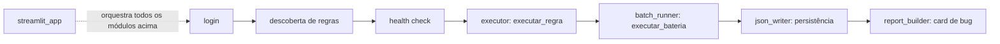

# Arquitetura

Visão geral dos módulos, do fluxo de dados e das decisões técnicas que não são óbvias só lendo o código.

## Fluxo principal

Cada seta é uma fronteira de módulo, não uma chamada direta obrigatória — `executor.py`, por exemplo, é usado tanto por `batch_runner.py` (dentro de uma bateria) quanto isoladamente (execução de uma regra só).

## Módulos

| Módulo | Responsabilidade |
|---|---|
| `core/models.py` | `Execucao`, `EtapaExecucao` (Pydantic v2) — o schema compartilhado com o dashboard `automation-dashboard-angular` |
| `core/config.py` | Carrega `.env` (URL, credenciais, cliente, ambiente) |
| `automation/login.py` | Login via Playwright, distingue sucesso de falha |
| `automation/discovery.py` | Mapeia todas as regras cadastradas, sem hardcode |
| `automation/health_check.py` | Checagens pré-voo (servidor, login, FTP/diretórios — os dois últimos como stub documentado, aguardando ambiente real) |
| `automation/executor.py` | Executa uma regra: aplica, consulta log, monta `Execucao` |
| `automation/batch_runner.py` | Roda todas as regras ativas em sequência, com reset entre uma e outra e agregado de lote |
| `reporting/json_writer.py` | Persiste `Execucao`/lote em `data/execucoes/*.json` e relê o histórico |
| `reporting/report_builder.py` | Monta o card de bug (Markdown semi-preenchido) a partir de uma execução com falha |
| `ui/streamlit_app.py` | Interface web — orquestra os módulos acima, sem lógica de negócio própria |

## Modelo de dados

`Execucao` usa `alias_generator` do Pydantic para expor os campos em `camelCase` no JSON (compatível com o TypeScript do dashboard) enquanto o código Python usa `snake_case` nativamente — nenhum dos dois lados precisa abrir mão da própria convenção. Dois campos (`total_etapas`, `etapas_com_sucesso`) são `computed_field`, sempre derivados da lista `etapas`, nunca definidos manualmente.

Dois critérios de tipagem valem a pena registrar porque não são óbvios:

- **`Literal` fechado vs. `str` aberto:** campos de estado do próprio sistema (`status`, `ambiente`) usam `Literal` — valor fora da lista é erro. Campos que representam entidades de negócio abertas (`cliente`, `tipo_teste`, o nome de uma regra) ficam `str` puro — fechar isso obrigaria atualizar o modelo toda vez que uma regra ou cliente novo aparecesse.
- **`Pydantic BaseModel` vs. `dataclass`:** modelos que recebem dado de fora com tipagem duvidosa (HTML raspado, variável de ambiente, JSON persistido) usam Pydantic, que valida/converte na entrada. Estruturas montadas só com valores que o próprio código já produziu (agregados como `ResultadoBateria`, resultado de health check) usam `dataclass` — não há nada para validar.

## Decisões técnicas que custaram tempo de debugging

Vale saber destas antes de mexer em código relacionado:

- **`coverage.py` subestima cobertura de código que usa Playwright síncrono.** A API síncrona usa `greenlet` por baixo; sem `concurrency = ["greenlet", "thread"]` em `[tool.coverage.run]`, funções inteiras aparecem com metade da cobertura mesmo com teste passando.
- **`computed_field` + `extra="forbid"` quebra round-trip de serialização.** Um campo computado aparece no JSON de saída, mas o mesmo `extra="forbid"` que impede alguém de setá-lo manualmente também rejeita essa chave na entrada. Reler o próprio JSON gerado exige descartar essas chaves antes de validar (`json_writer.py`).
- **Playwright síncrono não sobrevive a `@st.cache_resource` no Streamlit.** A conexão fica presa à thread do sistema operacional que a criou, e o Streamlit reexecuta cada interação em threads diferentes — cachear uma `Page` entre reruns quebra com erro de troca de thread. A solução foi abrir e fechar o Playwright inteiro dentro de cada ação (um context manager), nunca cacheado.
- **Mudança de schema exige checar o lado espelhado.** `Execucao` é lida pelo dashboard Angular (schema em TypeScript); qualquer campo novo (como `nome_regra`, adicionado depois que o card de bug precisou do nome específico da regra, não só do tipo) precisa ser considerado nos dois lados quando a integração real acontecer (ver [Roadmap](../README.md#roadmap--fases-futuras) no README).

## Ambiente de teste e testes automatizados

Detalhes do ambiente mock: [README, seção "Ambiente de teste"](../README.md#ambiente-de-teste-fase-1). Padrão de fixtures e por que a UI fica fora da métrica de cobertura: [`tests/README.md`](../tests/README.md).
